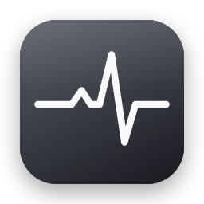
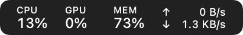
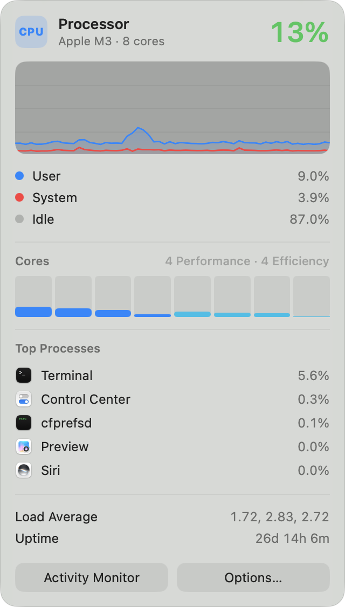
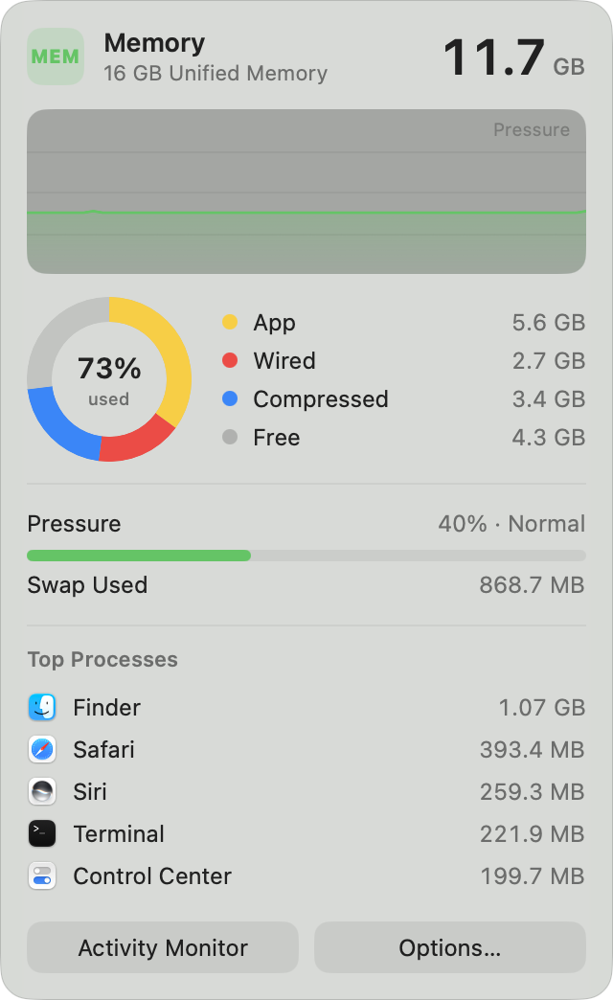
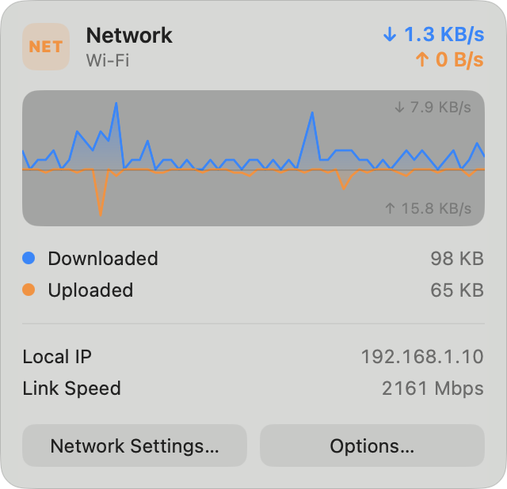
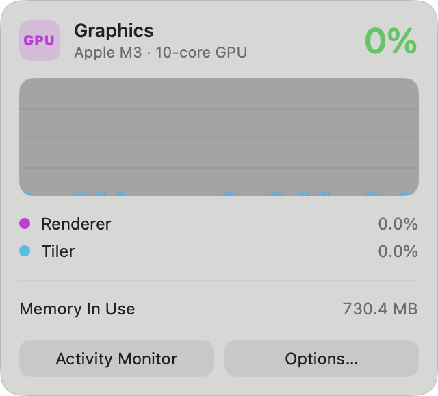

<p align="center">
  
</p>

<h1 align="center">Pulse</h1>

<p align="center">A small, quiet system monitor for the macOS menu bar.<br>CPU, GPU, memory and network at a glance, with a detail panel one click away.</p>

<p align="center">
  
</p>

<p align="center">
  
  
  
  
</p>

## Features

- **Menu bar readouts** for CPU, GPU, memory and network that blend in with the system icons, including dimming on inactive displays.
- **Detail panels:** history graphs, per-core load, memory breakdown and pressure, and top processes.
- **Your layout:** ⌘-drag items to reorder them among other menu bar apps, or hide the ones you don't need.
- **Light on resources:** about 1–3% CPU, with a 1, 2 or 3 second update interval.
- **Open at Login** and **Quit** from the Options menu.
- **Private:** everything is read locally from macOS. Pulse makes no network requests.

## Requirements

macOS 14 Sonoma or later. Built with Swift, SwiftUI and AppKit, with no third-party dependencies.

## Build

```sh
git clone https://github.com/merteminoglu/Pulse.git
cd Pulse
xcodebuild -project Pulse.xcodeproj -scheme Pulse -configuration Release -derivedDataPath build build
open build/Build/Products/Release/Pulse.app
```

Or open `Pulse.xcodeproj` in Xcode and press ⌘R. Run the tests with ⌘U.

For **Open at Login**, move `Pulse.app` to `/Applications` first.

## Usage

| Action | Result |
|---|---|
| Click an item | Open or close its panel |
| Right-click an item, or **Options…** in a panel | Show/hide items, update interval, Open at Login, Quit |
| ⌘-drag an item | Move it anywhere in the menu bar |
| Esc or click outside | Close the panel |

## License

[MIT](LICENSE)
